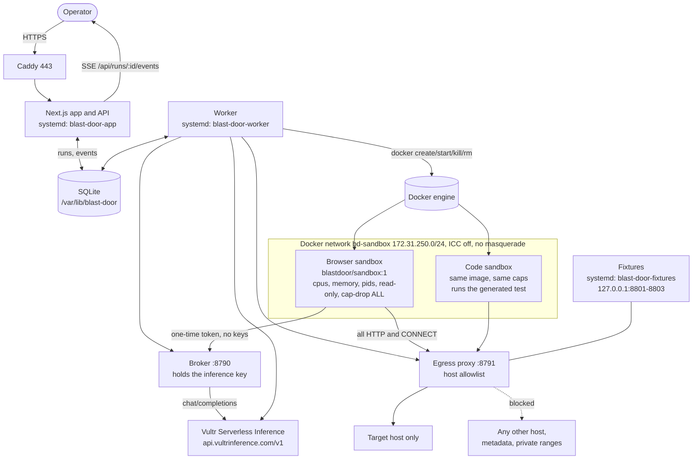
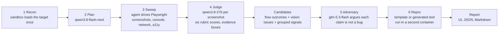

# Architecture

Everything runs on one Vultr VM (vc2-2c-4gb, region ewr, Ubuntu 24.04). Caddy terminates HTTPS on an sslip.io name derived from the VM address, so there is no domain to buy. Next.js serves the UI and the API, a worker process owns orchestration, and SQLite on the VM disk holds run state. Browser work never runs in the app process: every task gets a fresh container on a private Docker network.

## Pipeline

Each stage writes events to SQLite as it goes. The UI reads them over SSE, so the receipts feed is the same data the report is built from.

## Why the container is the unit of trust

The browser is the part most likely to be attacked, because page content is attacker-controlled by definition. So the browser gets no secrets and no reach:

- The container environment holds `HOME`, `PATH`, `LANG`, `LC_ALL`, `PLAYWRIGHT_BROWSERS_PATH`, `NODE_ENV` and `NPM_CONFIG_UPDATE_NOTIFIER`. Nothing else. The inference key never leaves the host.
- The agent's model calls go to the broker at `172.31.250.1:8790` with a one-time token written into `/work/task.json`. The broker burns the token, issues the next one in the chain, screens the observation, calls Vultr, and returns only a validated action.
- All page traffic goes through the egress proxy at `172.31.250.1:8791`, which resolves the hostname, refuses private, loopback, link-local and metadata addresses, and allows only the run's target host.
- `scripts/net-setup.sh` makes the network itself refuse the rest: no masquerade, no inter-container traffic, DOCKER-USER drops forwarded packets from the bridge, and the host INPUT chain accepts only the broker and proxy ports from `bd0`.
- Caps: `--cpus`, `--memory`, `--memory-swap` equal to memory so swap cannot be used to dodge the cap, `--pids-limit`, `--read-only` with a small tmpfs, `--cap-drop ALL`, `--security-opt no-new-privileges`, default seccomp, a non-root user, no Docker socket, and the per-task output directory as the only mount.
- The orchestrator enforces a wall clock, samples cgroup v2 counters every 300ms, destroys the container in a `finally` block, and verifies destruction with `docker inspect`. A reaper removes anything labelled `blastdoor.managed=1` that it does not own at startup and every minute.

## Trust boundaries

| Boundary | Crossing | Control |
| --- | --- | --- |
| Page to agent | Visible text, DOM, titles | Wrapped in `<untrusted_page>`, hidden text quarantined, heuristics plus `nemotron-3.5-content-safety` screen it, and the action schema allows only click, fill, select, goto, scroll, back and done |
| Agent to host | Broker HTTP call | One-time chained token, per-task call cap, action validated against the element list and the host allowlist |
| Container to network | HTTP and CONNECT | Proxy allowlist plus iptables, so a bypass attempt reaches nothing |
| Container to host | `/work` mount | Only the task directory, written as uid 1001, read back as JSON by the orchestrator |
| Generated test to host | Test source | `validateTest` rejects anything but `@playwright/test`, bans `process`, `require`, `fs` and dynamic import, and pins the hosts it may visit |
